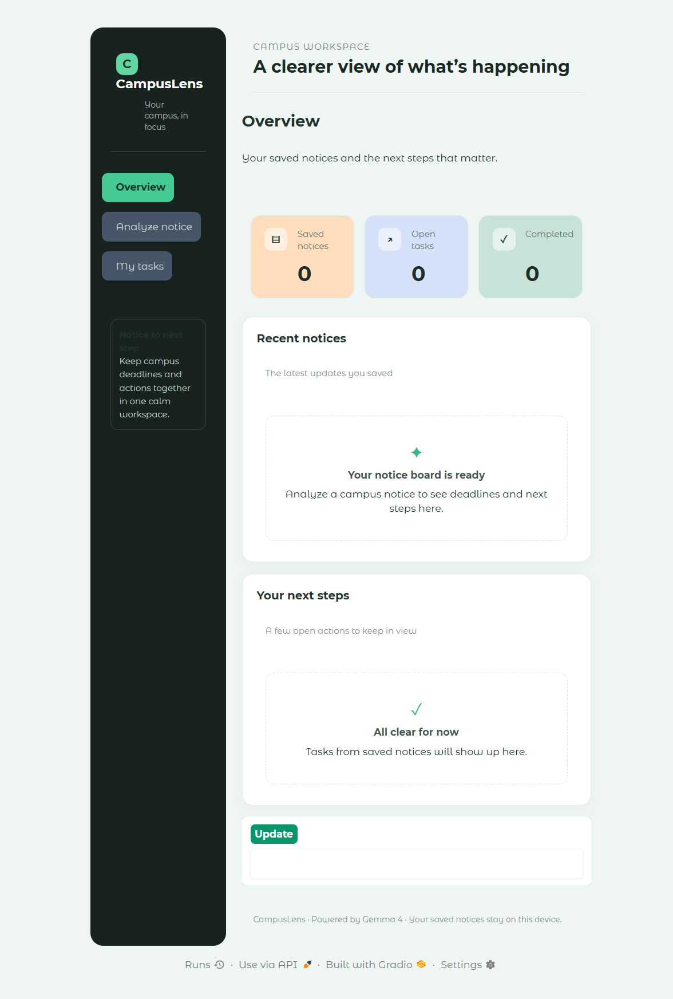
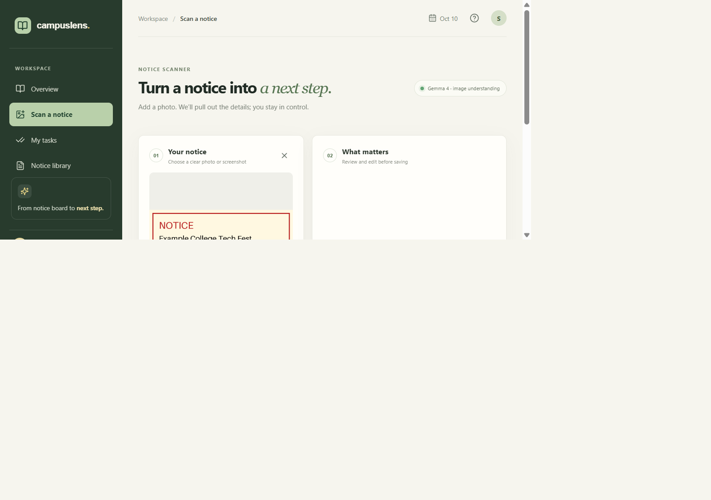
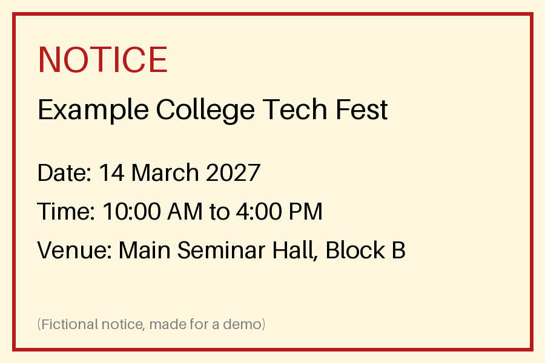

# CampusLens

**CampusLens turns campus notices into clear deadlines and next steps.** Upload a notice photo, review the facts Gemini's required Gemma 4 model extracts, then save its actionable items as searchable tasks.





## What it does

- A custom React dashboard with an overview, notice scanner, task center, and saved-notice library.
- Dashboard summary cards link to their related lists; saved notices open a detail view with a shortcut to related tasks.
- Image upload with side-by-side source preview and editable extraction results.
- Extracts title, deadline, venue, eligibility, and action items without inventing missing details.
- Persists notices and tasks in a local JSON file.
- Searches notices and tasks, filters tasks by status, and tracks completion.
- Includes an in-app quick guide, API connection check, workspace privacy details, and a saved reduced-motion preference.
- Uses only `gemma-4-26b-a4b-it` for model inference. Validation, persistence, search, and task operations are Python code.

## Stack

- React, TypeScript, Vite, and custom responsive CSS.
- FastAPI local API.
- Python JSON task manager.
- Google Gemini API with Gemma 4 `gemma-4-26b-a4b-it`.

## Setup (Windows PowerShell)

From the repository root:

```powershell
py -m venv .venv
.\.venv\Scripts\Activate.ps1
python -m pip install -r requirements.txt
Copy-Item .env.example .env
notepad .env
```

Add your own `GEMINI_API_KEY` to `.env`. Never commit that file or share the key.

Install the frontend dependencies in a second terminal:

```powershell
cd frontend
npm install
```

## Run locally in development

Terminal 1, from the repository root:

```powershell
python -m uvicorn server:app --host 127.0.0.1 --port 8000 --reload
```

Terminal 2:

```powershell
cd frontend
npm run dev
```

Open [http://127.0.0.1:5173](http://127.0.0.1:5173). Vite forwards `/api` requests to the local FastAPI service.

## Build and serve the production frontend

```powershell
cd frontend
npm run build
cd ..
python -m uvicorn server:app --host 127.0.0.1 --port 8000
```

Open [http://127.0.0.1:8000](http://127.0.0.1:8000). FastAPI serves the built React app and API from the same local origin.

## Tests

Python tests (no key or live model request required):

```powershell
python -m pip install -r requirements-dev.txt
python -m pytest -q
```

Frontend production build:

```powershell
cd frontend
npm run build
```

## Data and privacy

Saved notices and tasks are stored at `data/campus_data.json`. The JSON file is ignored by Git. Uploaded images are temporarily written for model analysis and deleted after the request; saving a notice does not retain the original image. The app listens on `127.0.0.1` by default. Notice images are sent to Google's Gemini API when you request analysis.

## Team branches

| Member | Branch | Focus |
|---|---|---|
| 1 | `feature/gemma-ai` | Image extraction |
| 2 | `feature/ui` | React interface |
| 3 | `feature/tasks` | Persistent tasks |
| 4 | `feature/tools` | Agent tools |
| 5 | `feature/testing-docs` | Tests and submission documentation |

The React frontend is served by Vite during development. The stable Python interfaces are in `server.py` and `task_manager.py`; coordinate schema changes before merging parallel work.

## Demo & Architecture



CampusLens turns campus notices and circulars into structured deadlines, actionable tasks, and a searchable knowledge base using Google's `gemma-4-26b-a4b-it`.

## License

This project is licensed under the MIT License; see [LICENSE](LICENSE).
